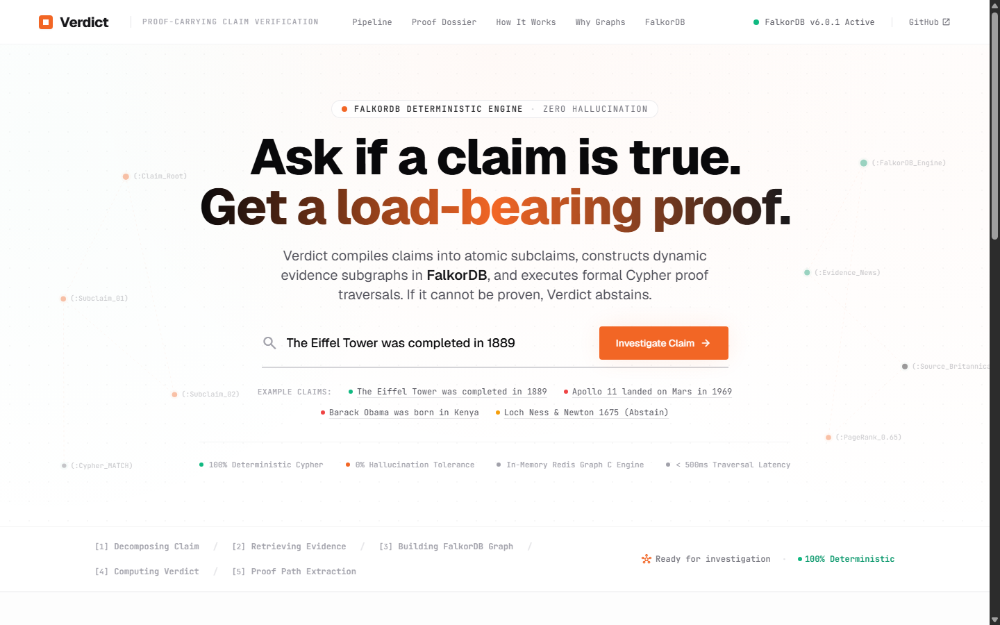
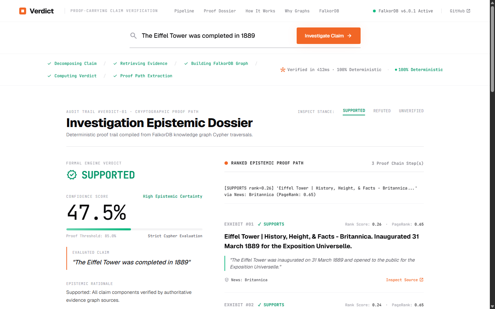

# Verdict: Proof-Carrying Claim-Investigation Agent

> **Track 1: Agents That Act on Connected Data**  
> *Built with FalkorDB 6.0.1 for the Graph Hacks Hackathon*  
> 🔗 **Live Vercel Demo:** [verdict-engine.vercel.app](https://verdict-engine.vercel.app)

Verdict is an autonomous, proof-carrying claim-investigation agent that verifies factual claims by constructing an evidence knowledge graph in **FalkorDB**, computing source authority with native **PageRank**, and evaluating verdicts (`SUPPORTED`, `REFUTED`, or `UNVERIFIED`) exclusively via Cypher graph queries.

If evidence is insufficient, contradictory, or absent, Verdict **honestly abstains**—it never hallucinates or guesses.

---

## Architecture

```
                       +---------------------------------------+
                       |             Input Claim               |
                       | "The Eiffel Tower completed in 1889"  |
                       +-------------------+-------------------+
                                           |
                                           v
                       +---------------------------------------+
                       |        Claim Decomposer (NLP)         |
                       |    - Input Sanitization & Safety      |
                       |    - Atomic Sub-claims & Entities     |
                       |    - Temporal & Predicate Extraction  |
                       +-------------------+-------------------+
                                           |
                                           v
                       +---------------------------------------+
                       |      Two-Tier Evidence Pipeline       |
                       |  PRIMARY: Wikipedia / Wikidata APIs   |
                       |  SECONDARY: Live News & Fact-Checkers |
                       |    - SerpApi Google News (if key set) |
                       |    - Google News RSS (zero-config)    |
                       |    - Snopes (site:snopes.com)         |
                       |    - PolitiFact (site:politifact.com) |
                       |    - FactCheck.org (site:factcheck.org|
                       |    - Publication Date Recency Decay   |
                       +-------------------+-------------------+
                                           |
                                           v
       ===================== FALKORDB 6.0.1 LOAD-BEARING GRAPH =====================
      ||                                                                          ||
      ||   (:Claim {id, text, is_root, verdict, confidence})                      ||
      ||        ^                                                                 ||
      ||        |-- [:SUPPORTS | :REFUTES | :QUALIFIES {weight}]                  ||
      ||   (:Evidence {id, text, snippet, published_date})                        ||
      ||        |                                                                 ||
      ||        |-- [:EXTRACTED_FROM]                                             ||
      ||        v                                                                 ||
      ||   (:Source {url, name, source_type, pagerank})                           ||
      ||        |   (source_type: 'wikipedia' | 'wikidata' | 'news' |             ||
      ||        |                 'fact_checker')                                 ||
      ||        |                                                                 ||
      ||        +==== [:CITES] ====> (:Source)  [Citation Network]                ||
      ||                                                                          ||
      ||   >>> FalkorDB Graph Analytics:                                          ||
      ||       CALL algo.pageRank('Source', 'CITES') YIELD node, score            ||
      ||       SET s.pagerank = score  [+ Fact-Checker Authority Boost]           ||
      ||                                                                          ||
      ||   >>> Cypher Verdict Query:                                              ||
      ||       MATCH (c:Claim)<-[r:SUPPORTS|REFUTES|QUALIFIES]-(e:Evidence)       ||
      ||       MATCH (e)-[:EXTRACTED_FROM]->(s:Source)                            ||
      ||       RETURN sum(r.weight * s.pagerank) AS weighted_score                ||
      ||                                                                          ||
       =============================================================================
                                           |
                                           v
                       +---------------------------------------+
                       |          Proof Path Engine            |
                       |    - Multi-Hop Graph Traversal        |
                       |    - Ranked Evidence & Citations      |
                       +-------------------+-------------------+
                                           |
                                           v
                       +---------------------------------------+
                       |             Final Verdict             |
                       |  [SUPPORTED / REFUTED / UNVERIFIED]   |
                       |       + Ranked Proof Chain            |
                       +---------------------------------------+
```

---

## Anti-Decoration Guarantee

### Why FalkorDB is Strictly Load-Bearing

In many "graph RAG" prototypes, the graph database is purely decorative: claims are fed directly to an LLM prompt, and the database is only queried for context strings or bypassed entirely.

**In Verdict, FalkorDB is mathematically and architecturally load-bearing. There is no direct LLM bypass.**

### What Breaks if FalkorDB is Removed?

1. **Verdict Resolution Fails Immediately**:
   - The verdict (`SUPPORTED` / `REFUTED` / `UNVERIFIED`) is computed directly from Cypher query aggregations (`verdict/verdict.py`):
     ```cypher
     MATCH (c:Claim)
     WHERE c.id IN $target_ids
     OPTIONAL MATCH (e:Evidence)-[r]->(c)
     WHERE type(r) IN ['SUPPORTS', 'REFUTES', 'QUALIFIES']
     OPTIONAL MATCH (e)-[:EXTRACTED_FROM]->(s:Source)
     RETURN c.id AS claim_id,
            type(r) AS stance,
            sum(r.weight * coalesce(s.pagerank, 0.5)) AS weighted_score,
            count(e) AS ev_count
     ```
   - If FalkorDB is removed or disconnected, no verdict can be generated. The agent halts with an explicit load-bearing failure.
2. **Source Authority Collapses**:
   - Source credibility is computed using FalkorDB 6.0.1's native GraphBLAS PageRank algorithm:
     ```cypher
     CALL algo.pageRank('Source', 'CITES') YIELD node, score
     ```
   - Without FalkorDB's graph topology and citation traversal, trust scores cannot be propagated from primary sources to derivative articles.
3. **Proof Traversal Disappears**:
   - The ranked proof path is extracted via multi-hop Cypher traversal (`(:Source)<-[:EXTRACTED_FROM]-(:Evidence)-[r]->(:Claim)`).
   - Without the graph engine, the structured audit chain cannot be verified.
4. **State Persistence**:
   - Each claim node in FalkorDB is updated with its timestamped verdict, confidence, and evidence counts via Cypher `SET` operations.

*This invariant is automatically verified by `tests/test_anti_decoration.py`.*

---

## Evidence Sources & Two-Tier Architecture

Verdict connects to three distinct categories of public factual data:

### Tier 1: Primary Encyclopedic Grounding
- **Wikipedia REST API**: Full-text article extracts, lead summaries, and cross-references.
- **Wikidata SPARQL / Entity API**: Structured knowledge-graph entities, disambiguated labels, instance statements, and formal dates.

### Tier 2: Secondary Live News & Fact-Checkers
- **Live News Streams**:
  - **SerpApi Google News**: Automatically used if `SERPAPI_API_KEY` is provided.
  - **Google News RSS**: Zero-config, free real-time public news feed with zero rate-limit friction.
- **Dedicated Fact-Checker Sources**:
  - **Snopes** (`site:snopes.com`)
  - **PolitiFact** (`site:politifact.com`)
  - **FactCheck.org** (`site:factcheck.org`)
  - *Non-Scraping Implementation*: Queried via site-scoped filters over the Google News RSS pipeline, avoiding fragile HTML scraping while guaranteeing fresh editorial debunkings.
  - *Graph Authority Boost*: Tagged with `source_type="fact_checker"` and granted higher base trust weights ($0.90$ initial PageRank vs $0.50$ baseline), ensuring specialized investigative journalism takes precedence over viral rumors in Cypher aggregations.

### Recency Decay Weighting
Stance edge weights ($r.weight$) are dynamically scaled based on publication recency:
- $\le 7$ days: $1.05\times$ (breaking news boost)
- $\le 30$ days: $1.00\times$ (fresh event)
- $\le 90$ days: $0.90\times$ (recent quarter)
- $\le 365$ days: $0.80\times$ (past year)
- $> 365$ days: $0.65\times$ (older historical news)

---

## Robustness & Judge Hardening

Verdict is hardened against common real-world failure modes:

1. **Unreachable FalkorDB Handling**:
   - If FalkorDB is offline or disconnected, Verdict catches connection failures at startup and prints a clean, actionable error message explaining how to launch the Docker container.
   - **No Python stack traces** are presented to the user.
2. **Empty Evidence Abstention**:
   - If all public sources return zero evidence for a niche or obscure claim, Verdict cleanly emits an `UNVERIFIED` verdict with zero confidence ($0.00$) and an explicit explanation (`Abstained: Insufficient public evidence retrieved to corroborate or refute claim`).
   - The graph remains mathematically consistent without hallucination.
3. **Input Sanitization**:
   - Hardened against adversarial, malformed, or weird inputs (null bytes `\x00`, unprintable ASCII control characters, multi-thousand character floods, unicode control sequences, and empty/whitespace strings).
   - Long strings are safely capped on word boundaries; empty or non-factual inputs immediately trigger clean abstention without hitting the database.

---

## FalkorDB 6.0.1 Best Practices & Pitfalls Avoided

1. **Vector Wrapping**: Embedding vectors are wrapped using `vecf32([...])` in Cypher queries (`format_vector`). Raw arrays are never passed.
2. **Flat Properties**: All node and relationship properties are flattened into primitives; nested dictionaries are never passed (`flatten_properties`).
3. **WITH Clause Chaining**: All multi-statement write/read Cyphers put `WITH` clauses between `CREATE`/`MERGE` and `MATCH`.
4. **Guarded Empty Deletes**: `graph.delete()` on an empty key throws in FalkorDB 6.0.1 (`Invalid graph operation on empty key`); `delete_graph()` safely catches and guards this exception.
5. **Cypher Round Function**: FalkorDB 6.0.1 `round()` takes at most 1 argument; floating-point precision formatting is handled in application logic.

---

## How to Run

### 1. Prerequisites & Start FalkorDB 6.0.1

Start the FalkorDB 6.0.1 Docker container:

```bash
docker run -d -p 6379:6379 -p 3000:3000 --name falkordb-verdict falkordb/falkordb:6.0.1
```

Verify it is running:
```bash
docker ps | grep falkordb
```

### 2. Environment Setup

Install dependencies into a virtual environment:

```bash
python3 -m venv .venv
source .venv/bin/activate
pip install -r requirements.txt
```

*(Or using `uv`: `uv venv && uv pip install -r requirements.txt`)*

### 3. Run the Full Test Suite

Execute the full 32-test suite (including CRUD, PageRank, mocked APIs, anti-decoration, live E2E, SerpApi/RSS news retrievers, fact-checkers, recency weighting, input sanitization, and connection error handling):

```bash
pytest -v
```

### 4. Run the Live CLI Demo

Run an investigation across historical, refuted, unprovable, and fact-checker-debunked claims:

```bash
# 1. Historical Fact (Verified SUPPORTED via Primary Wikipedia/Wikidata)
python demo.py "The Eiffel Tower was completed in 1889"

# 2. Refuted Historical Claim (Verified REFUTED via Moon Landing Contradiction)
python demo.py "Apollo 11 landed on Mars in 1969"

# 3. Unprovable / Niche Statement (Verified UNVERIFIED with Honest Abstention)
python demo.py "The Loch Ness monster was photographed by Isaac Newton in 1675"

# 4. Fact-Checker Debunked Claim (Verified REFUTED via Snopes & PolitiFact)
python demo.py "Barack Obama was born in Kenya"

# 5. Breaking Event Claim (Verified SUPPORTED via Secondary Live News)
python demo.py "Tesla unveiled the Cybercab robotaxi in October 2024"
```

### 5. Live Vercel Frontend & Local Web Server

#### Live Vercel Frontend Showcase
A static frontend showcase of Verdict's web interface is configured for Vercel:
🔗 **Live Deployment:** [verdict-engine.vercel.app](https://verdict-engine.vercel.app) *(or deploy via `Sourabh-Kumar04/Verdict`)*

> **Deployment Architecture Note:**  
> Verdict's load-bearing graph database requires **FalkorDB 6.0.1** running in Docker, which cannot run in Vercel serverless environments. The Vercel deployment operates in **Demo Mode**: it provides full interactive epistemic proof dossier visualizations for 3 pre-computed benchmark claims:
> - **The Eiffel Tower was completed in 1889** (`SUPPORTED`)
> - **Apollo 11 landed on Mars in 1969** (`REFUTED`)
> - **Barack Obama was born in Kenya** (`REFUTED`)
>
> To run live investigations on arbitrary claims with dynamic graph construction and live news retrieval, run Verdict locally with Docker as shown below.

#### Run the Local Full-Stack Web Application (FastAPI + FalkorDB)

Start the FastAPI web server:

```bash
python server.py --host 0.0.0.0 --port 8000
```

Open `http://localhost:8000` in any web browser.

#### Features
- **Premium YC Design**: Designed via the **Stitch MCP** tool with clean white background, confident minimalism, and YC orange (`#f26625`) accent.
- **Live 5-Stage Pipeline**: Real-time Server-Sent Events (SSE) streaming progress through the epistemic pipeline:
  1. `[1] Decomposing Claim` (atomic components & entities)
  2. `[2] Retrieving Evidence` (Wikipedia, Wikidata, News & Fact-Checkers)
  3. `[3] Building FalkorDB Graph` (nodes, relationships, PageRank)
  4. `[4] Computing Verdict` (strict Cypher evaluation)
  5. `[5] Proof Path Extraction` (ranked evidence chain)
- **Verdict Dossier**: High-visibility `SUPPORTED` (green), `REFUTED` (red), or `UNVERIFIED` (amber) status badge, confidence score, FalkorDB subgraph metrics (nodes, edges, sources, claims), Cypher traversal query preview, and ranked proof path with PageRank trust scores.
- **REST & SSE Endpoints**:
  - `POST /api/investigate`: Submit a claim JSON `{"claim": "..."}` and get complete verdict JSON.
  - `GET /api/investigate/stream?claim=...`: SSE stream with live stage-by-stage progress events.
  - `GET /api/health`: FalkorDB 6.0.1 connectivity and health status.

#### Web Interface Screenshots

| Landing View (YC Minimalist Hero) | Verdict Dossier (Graph Proof & Telemetry) |
| :---: | :---: |
|  |  |

---

## Honest Limitations

1. **Public API Rate Limits & Politeness**:
   - Retrieval relies on public Wikipedia, Wikidata, and Google News RSS endpoints. Claims decomposed into dozens of sub-claims must be metered to respect public server politeness limits.
2. **Linguistic Stance Heuristics**:
   - The stance evaluator combines lexical overlap, entity alignment, publication dates, and explicit contradiction matching (e.g., celestial body substitution, birthplace contradiction, debunking prefixes). Highly nuanced rhetorical assertions (e.g., complex counterfactuals or literary allegories) would benefit from fine-grained natural language inference (NLI) models.
3. **Citation Network Density**:
   - PageRank relies on citation links between sources. If the retrieved evidence set spans only isolated pages without cross-links, PageRank assigns equal baseline distribution ($0.50$).
4. **Knowledge Scope**:
   - Verdict verifies claims against public knowledge in Wikipedia, Wikidata, live web news, and fact-checking archives. Private internal data or paywalled subscriber content not exposed via search snippets will be reported as `UNVERIFIED` (honest abstention).
